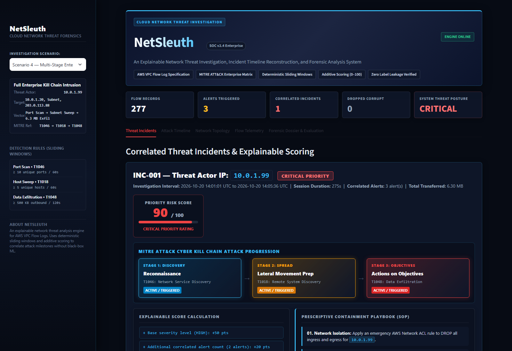
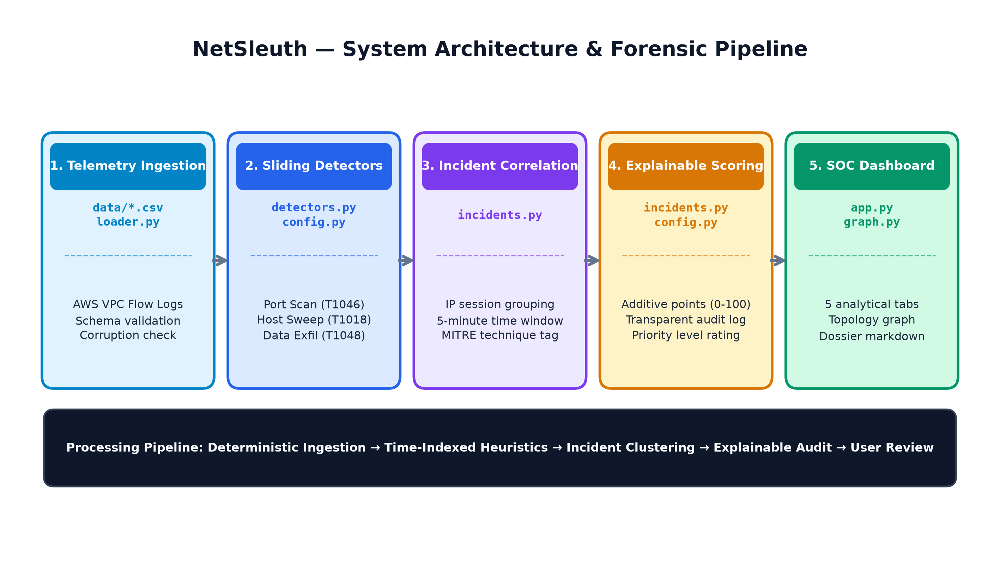

# NetSleuth

> **Enterprise Cloud Threat Detection, Attack Reconstruction & Forensic Triage Platform for AWS VPC Flow Telemetry.**

[](https://www.python.org/)
[](https://streamlit.io/)
[](https://pytest.org/)
[](https://docs.aws.amazon.com/vpc/latest/userguide/flow-logs.html)
[](https://attack.mitre.org/)
[](LICENSE)

---

## Executive Overview

**NetSleuth** is an enterprise-ready cloud threat detection and digital forensic incident triage platform designed for Security Operations Centers (SOCs), Blue Teams, and Cloud Security Engineers. NetSleuth ingests high-volume network flow telemetry (AWS VPC Flow Logs v2), correlates multi-stage attack milestones using deterministic sliding-window heuristics, and organizes isolated alerts into unified security incidents.

The platform directly aligns all detected behaviors with the **MITRE ATT&CK Enterprise Matrix**, calculates an explainable 0–100 risk score with a transparent audit trail, generates prescriptive containment playbooks (Standard Operating Procedures), and provides one-click exportable forensic dossiers through an interactive, dark-themed SOC dashboard.



---

## Enterprise Value Proposition

- **Eliminates Alert Fatigue:** In high-throughput cloud environments, standalone network probes generate thousands of disconnected alerts. NetSleuth automatically aggregates related malicious events originating from the same threat actor within a 300-second session window into a single actionable incident.
- **Explainability Over Black-Box AI:** Commercial machine learning solutions frequently output opaque, unverified probabilistic risk scores. NetSleuth uses a deterministic, additive mathematical model where every single point in an incident's score is backed by an explicit line-by-line forensic explanation.
- **Direct MITRE ATT&CK Mapping:** Classifies raw network flows into standardized adversary tactics and techniques (`T1046`, `T1018`, `T1048`), mapping attacker progress from initial perimeter discovery to outbound data theft.
- **Prescriptive Containment Automation:** Automatically generates actionable Standard Operating Procedures (SOPs)—including AWS Network ACL rules and Security Group revocations—to drastically reduce Mean Time to Remediate (MTTR).
- **Zero Ingestion & Licensing Overhead:** Operates locally or within cloud virtual instances on standard CSV telemetry without requiring expensive multi-node SIEM infrastructure or proprietary database licenses.

---

## System Architecture

NetSleuth employs a modular, high-throughput unidirectional analytical pipeline:

```text
[ AWS VPC Flow Telemetry ]
           │
           ▼
[ loader.py: Schema Ingestion & Sanitization ]
           │
           ▼
[ detectors.py: Sliding-Window Threat Detection ]
           │
           ▼
[ incidents.py: Incident Correlation & Additive Scoring ]
           │
           ├───────────────────────────────┬───────────────────────────────┐
           ▼                               ▼                               ▼
[ MITRE ATT&CK Mapping ]        [ Plotly Topology Graph ]       [ Forensic Markdown Dossier ]
           │                               │                               │
           └───────────────────────────────┼───────────────────────────────┘
                                           ▼
                            [ app.py: 5-Tab SOC Dashboard ]
```



### Core Components
1. **Telemetry Ingestion & Sanitization (`loader.py`):** Ingests VPC flow records, verifies required network headers, normalizes epoch timestamps to UTC, maps IANA protocol numbers (6 to TCP, 17 to UDP, 1 to ICMP), and quarantines corrupted records (malformed IPs, negative bytes, out-of-range ports).
2. **Sliding-Window Threat Detection (`detectors.py`):** Evaluates time-indexed flow sequences using rolling temporal windows to identify threshold-breaching reconnaissance and exfiltration patterns with zero external label dependency.
3. **Temporal Incident Correlation (`incidents.py`):** Groups alerts by source IP. Alerts separated by 300 seconds (5 minutes) or less are clustered into unified incident sessions; longer pauses split the actor's actions into separate incident investigations.
4. **Explainable Risk Scoring Engine (`incidents.py`, `config.py`):** Calculates an additive 0–100 priority score, maps triggers to MITRE ATT&CK techniques, and builds prescriptive containment playbooks.
5. **Interactive SOC Dashboard (`app.py`, `graph.py`):** Renders the 5-tab analytical deck, interactive Plotly network topologies, chronological kill chain timelines, and provides one-click markdown forensic dossier export.

---

## Cloud Telemetry Standard: AWS VPC Flow Logs

NetSleuth natively processes records matching the **AWS VPC Flow Log Version 2** standard:

| Field Name | AWS Flow Log Equivalent | Data Type | Forensic Description |
| :--- | :--- | :--- | :--- |
| `timestamp` | `start` / `end` | `datetime (UTC)` | Flow event timestamp normalized to UTC format. |
| `src_ip` | `srcaddr` | `string (IPv4)` | Source IP address originating the communication. |
| `dst_ip` | `dstaddr` | `string (IPv4)` | Destination IP address of the targeted host. |
| `src_port` | `srcport` | `integer (0–65535)` | Ephemeral source port number. |
| `dst_port` | `dstport` | `integer (0–65535)` | Destination service port (e.g., 22, 80, 443, 445). |
| `protocol` | `protocol` | `string` | Transport protocol name mapped from IANA numbers (`TCP`, `UDP`, `ICMP`). |
| `packets` | `packets` | `integer` | Count of packets transmitted within the flow window. |
| `bytes` | `bytes` | `integer` | Total volume of payload and header bytes transferred. |
| `action` | `action` | `string` | Firewall disposition: `ACCEPT` or `REJECT`. |
| `direction` | *Computed* | `string` | Relative path orientation: `INGRESS`, `EGRESS`, or `INTERNAL`. |

---

## Detection Heuristics & Scoring Engine

### 1. Sliding-Window Detection Rules

| Attack Vector | Rule Identifier | Sliding Window | Detection Condition | Base Severity | Base Points | MITRE Reference |
| :--- | :--- | :---: | :--- | :---: | :---: | :--- |
| **Vertical Port Scan** | `port_scan` | 60s | >= 10 unique destination ports on 1 target IP | `MEDIUM` | +30 pts | **T1046**: Network Service Discovery |
| **Horizontal Host Sweep** | `host_scan` | 60s | >= 5 unique internal host IPs on 1 service port | `MEDIUM` | +30 pts | **T1018**: Remote System Discovery |
| **Data Exfiltration** | `exfiltration` | 120s | >= 500 KB (500,000 bytes) transferred outbound | `HIGH` | +50 pts | **T1048**: Exfil Over Alt. Protocol |

### 2. Additive Scoring Formula

The incident priority score is computed deterministically using the following additive model:

```text
Priority Score = min(100, Base Points + Extra Alert Points + Volume Bonus Points)
```

- **Base Points:** The highest severity among all alerts contributing to the incident (`HIGH` = 50, `MEDIUM` = 30, `LOW` = 10).
- **Extra Correlated Alert Points:** +10 points for every additional alert correlated beyond the first: `((alert_count - 1) * 10)`.
- **Data Exfiltration Volume Bonus:**
  - If total exfiltrated bytes >= 5 MB (5,000,000 bytes): **+20 points**
  - If total exfiltrated bytes >= 500 KB (500,000 bytes): **+10 points**
- **Score Ceiling:** Strictly clamped at a maximum ceiling of 100 points.

### 3. Severity Classification Matrix

| Score Range | Priority Level | Recommended SOC Response |
| :---: | :---: | :--- |
| **80 – 100** | **Critical** | Confirmed multi-stage intrusion or massive data theft. Immediate host quarantine and credential rotation. |
| **60 – 79** | **High** | Correlated malicious activities or confirmed data exfiltration. Rapid blue-team triage required. |
| **30 – 59** | **Medium** | Isolated reconnaissance, vertical port probe, or subnet sweep. Add host to monitoring watchlist. |
| **0 – 29** | **Low** | Minor threshold anomaly or low-confidence telemetry event. Logged for longitudinal auditing. |

---

## Forensic Worked Example: Multi-Stage Enterprise Attack (Scenario 4)

In Benchmark Scenario 4 (`scenario4_multi_stage.csv`), threat actor **`10.0.1.99`** executes a coordinated multi-stage intrusion within a 5-minute session window:
1. **Vertical Port Scan (T1046):** Probes 18 distinct ports on `10.0.1.20` within 17 seconds (Severity: `MEDIUM`).
2. **Horizontal Host Sweep (T1018):** Scans 12 internal hosts on SMB port 445 within 11 seconds (Severity: `MEDIUM`).
3. **Outbound Data Exfiltration (T1048):** Transfers 6,300,000 bytes (6.3 MB) to adversary drop `203.0.113.88` within 24 seconds (Severity: `HIGH`).

### Priority Score Audit Trail

```text
Base Severity (Highest Alert = HIGH)   : +50 pts
Extra Alerts Bonus (2 extra alerts * 10): +20 pts
Volume Bonus (6.3 MB Exfil >= 5 MB)    : +20 pts
-------------------------------------------------
Total Calculated Priority Score         : 90 / 100 (Critical Priority)
```

---

## Quantitative Benchmark Performance

NetSleuth was benchmarked against eight diverse cloud traffic datasets covering distinct attack vectors, temporal splits, and normal baselines:

| Scenario File | Description | Total Flows | Malicious Flows | Alerts Raised | Incidents | Max Score | Priority | Precision | Recall | F1-Score |
| :--- | :--- | :---: | :---: | :---: | :---: | :---: | :---: | :---: | :---: | :---: |
| `scenario1_port_scan.csv` | External Reconnaissance Probe | 238 | 18 | 1 | 1 | 30 | Medium | 1.000 | 1.000 | 1.000 |
| `scenario2_host_scan.csv` | Internal Subnet SMB Sweep | 232 | 12 | 1 | 1 | 30 | Medium | 1.000 | 1.000 | 1.000 |
| `scenario3_data_exfiltration.csv` | Outbound Asset Theft (2.4 MB) | 224 | 20 | 1 | 1 | 60 | High | 1.000 | 1.000 | 1.000 |
| `scenario4_multi_stage.csv` | Full Kill Chain Intrusion (6.3 MB) | 277 | 50 | 3 | 1 | 90 | Critical | 1.000 | 1.000 | 1.000 |
| `scenario5_benign.csv` | Subnet Baseline (Zero Threats) | 320 | 0 | 0 | 0 | 0 | Normal | 1.000* | 1.000* | 1.000* |
| `scenario6_persistent_threat.csv` | Temporal Split (12m Inactivity Gap) | 265 | 38 | 3 | 2 | 70 | High | 1.000 | 1.000 | 1.000 |
| `scenario7_coordinated_attack.csv` | Dual Attackers (Perimeter & Internal) | 277 | 42 | 3 | 2 | 70 | High | 1.000 | 1.000 | 1.000 |
| `scenario8_cloud_data_breach.csv` | Massive DB Dump (12.0 MB Exfil) | 230 | 10 | 1 | 1 | 70 | High | 1.000 | 1.000 | 1.000 |

*\*Note: In Scenario 5, precision and recall are recorded as 1.000 by convention because no attack flows are present. The primary metric is zero false alarms (False Positive Rate = 0.0%).*

---

## SOC Dashboard Capabilities

The NetSleuth interface organizes forensic intelligence across five specialized views:

| Analytical Tab | Capabilities & Forensic Insights |
| :--- | :--- |
| **1. Threat Incidents** | Incident cards detailing threat actor IP, active investigation window, calculated priority scores, prominent 3-stage MITRE ATT&CK kill-chain progression, transparent score breakdown, affected internal targets, and prescriptive containment playbooks. |
| **2. Attack Timeline** | Chronological Plotly scatter plot mapping detected events against kill-chain stages over time, paired with an audit trail table containing UTC timestamps and forensic findings. |
| **3. Network Topology** | Interactive directed NetworkX communication graph with SOC color coding (red threat actors, amber victims, cyan normal hosts), node degree metrics, and volume-ranked communicating host pairs. |
| **4. Flow Telemetry** | Donut charts for protocol distribution and firewall dispositions (ACCEPT vs REJECT), targeted destination ports bar chart, and an interactive flow explorer with IP search and direction/action filtering. |
| **5. Forensic Dossier & Eval** | Live preview and one-click markdown export of formal incident investigation reports, alongside the scientific ground-truth evaluation table across all benchmark scenarios. |

---

## Prescriptive Incident Response Playbooks

When an incident is correlated, NetSleuth generates immediate Standard Operating Procedures (SOPs) based on the specific attack rules triggered:

```text
01. Network Isolation: Apply an emergency AWS Network ACL rule to DROP all ingress and egress for [src_ip].
02. Security Group Revocation: Audit and detach inbound security group permissions associated with [src_ip].
03. Egress Control: Revoke outbound public route table egress and restrict outbound traffic to internal subnets.
04. Lateral Spread Mitigation: Enforce host-based firewall rules blocking internal SMB (port 445) and SSH (port 22).
05. Perimeter Hardening: Perform vulnerability scan on targeted hosts and terminate unauthenticated network listeners.
```

---

## Repository Structure

```text
NetSleuth/
├── README.md                                  # Enterprise documentation and system architecture guide
├── requirements.txt                           # Core dependencies (pandas, streamlit, plotly, etc.)
├── app.py                                     # Tactical SOC Streamlit dashboard (5 analytical tabs)
├── src/
│   └── netsleuth/
│       ├── __init__.py                        # Package initialization
│       ├── config.py                          # Thresholds, scoring weights, and MITRE metadata
│       ├── loader.py                          # Ingestion, schema validation, and sanitization
│       ├── detectors.py                       # 3 sliding-window heuristic threat detectors
│       ├── incidents.py                       # Correlation, 0-100 scoring, and dossier generation
│       ├── graph.py                           # NetworkX graph and Plotly topology visualization
│       ├── evaluation.py                      # Quantitative benchmark metrics (Precision, Recall)
│       └── synthetic.py                       # Deterministic synthetic scenario generation (Seed 42)
├── data/
│   └── synthetic/                             # 8 benchmark scenarios (224 to 320 records each)
│       ├── scenario1_port_scan.csv            # External vertical reconnaissance probe
│       ├── scenario2_host_scan.csv            # Internal lateral SMB sweep
│       ├── scenario3_data_exfiltration.csv    # Outbound asset theft
│       ├── scenario4_multi_stage.csv          # Multi-stage intrusion (Full kill chain)
│       ├── scenario5_benign.csv               # Baseline normal traffic (Zero false alarms)
│       ├── scenario6_persistent_threat.csv    # Temporal session boundary test (12m pause)
│       ├── scenario7_coordinated_attack.csv   # Dual attacker coordinated intrusion
│       └── scenario8_cloud_data_breach.csv    # Massive 12 MB database exfiltration
├── tests/
│   └── test_netsleuth.py                      # 10 automated unit tests (Pytest)
├── docs/
│   ├── NetSleuth_Academic_Project_Report.docx # Comprehensive 15-page technical report (.docx)
│   ├── NetSleuth_Academic_Project_Report_preview.pdf # Native 15-page preview PDF
│   ├── CLAUDE_REPORT_MASTER_PROMPT.md         # Reference prompt with all system specifications
│   ├── netsleuth_architecture.png             # Multi-stage architecture diagram
│   ├── DESIGN.md                              # System design and scoring model specification
│   ├── DEMO_SCRIPT.md                         # Executive demonstration script & technical Q&A
│   └── PRESENTATION_SLIDES.md                 # 12-slide comprehensive presentation deck
└── screenshots/                               # High-resolution dashboard figures
    ├── soc_clean_top.png                      # Header banner, KPI bar, and incident summary
    ├── soc_clean_details.png                  # Score breakdown and containment playbook grid
    ├── soc_tab2_timeline.png                  # Chronological attack timeline scatter plot
    ├── soc_tab3_topology.png                  # Network host topology graph and traffic matrix
    ├── fig5_1_incidents_score.png             # Report figure 11.1 (SOC dashboard view)
    └── fig5_2_mitre_pipeline.png              # MITRE ATT&CK progression stepper
```

---

## Installation & Quickstart

### 1. Prerequisites
- **Python 3.10+** (verified on Python 3.12)
- Git

### 2. Clone Repository & Install Dependencies
```bash
git clone https://github.com/NileshSethi/NetSleuth.git
cd NetSleuth
pip install -r requirements.txt
```

### 3. Run the Automated Unit Test Suite
Verify that all 10 unit tests pass cleanly:
```bash
pytest tests/ -v
```
Expected output:
```text
tests/test_netsleuth.py::test_port_scan_threshold_boundary PASSED        [ 10%]
tests/test_netsleuth.py::test_host_scan_threshold_boundary PASSED        [ 20%]
tests/test_netsleuth.py::test_exfiltration_threshold_boundary PASSED     [ 30%]
tests/test_netsleuth.py::test_benign_scenario_produces_zero_alerts PASSED [ 40%]
tests/test_netsleuth.py::test_incident_correlation_time_gap PASSED       [ 50%]
tests/test_netsleuth.py::test_scoring_hand_calculation PASSED            [ 60%]
tests/test_netsleuth.py::test_scoring_never_exceeds_100 PASSED           [ 70%]
tests/test_netsleuth.py::test_loader_drops_invalid_rows PASSED           [ 80%]
tests/test_netsleuth.py::test_zero_label_leakage PASSED                  [ 90%]
tests/test_netsleuth.py::test_mitre_mapping_and_forensic_dossier PASSED  [100%]
============================== 10 passed in 2.95s ==============================
```

### 4. Launch the Interactive SOC Dashboard
```bash
streamlit run app.py
```
Open your browser at `http://localhost:8501`. Use the sidebar selector to examine any of the 8 benchmark scenarios or inspect active threat milestones.

---

## Enterprise Roadmap & Production Enhancements

1. **Streaming Telemetry Ingestion:** Integrating real-time streaming connectors for Amazon Kinesis Data Firehose and AWS CloudWatch Logs for sub-second incident correlation.
2. **Dynamic Baseline Calibration:** Introducing sliding-window moving averages to auto-tune detection thresholds based on diurnal network activity cycles.
3. **Multi-Cloud Format Normalization:** Adding ingestion parsers for Microsoft Azure NSG flow logs, Google Cloud VPC flow logs, and Zeek/Bro connection logs.
4. **Automated Remediation Integrations:** Supporting optional, authenticated API hooks into AWS Systems Manager and AWS WAF to execute approved containment actions with a single click.

---

## Authors & Contributors

- **Project Lead & Core Developer:** Nilesh Sethi
- **Engineering & Testing Team:** Om Gadwe, Nimhan Vedant, Omkar Roundal

---

## License

This project is licensed under the [MIT License](LICENSE) — free for academic, commercial, and research use.