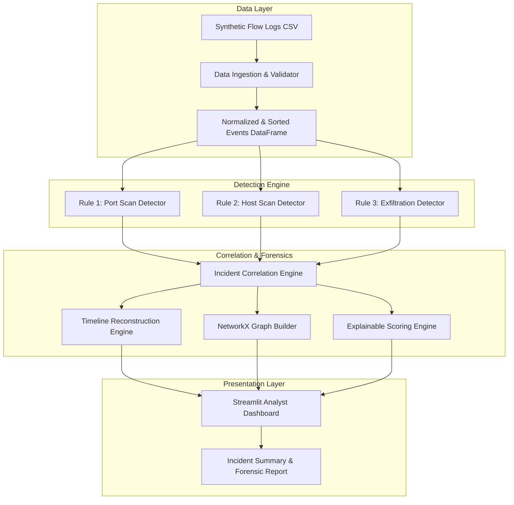

# NetSleuth

> **NetSleuth: An Explainable Network Attack Timeline Reconstruction and Threat Analysis System**

[](#current-project-status)
[](#technology-stack)
[](#license)

---

## ⚠️ Development Notice
**NetSleuth is currently in active Phase 1 (Scaffolding & Architecture).**  
Core detection algorithms, correlation engines, and dashboard features are planned and specified in detail, but are not yet implemented. All data processing currently described pertains to planned execution against local, synthetic cloud-style flow records.

---

## 1. Executive Summary & Problem Statement

Modern enterprise and cloud environments generate millions of network-flow records per hour (e.g., AWS VPC Flow Logs, Cisco NetFlow, IPFIX). Security Operations Center (SOC) analysts faced with this deluge of telemetry confront three critical bottlenecks:
1. **Alert Fatigue & Fragmented Context:** Disjointed alerts from disparate detection systems lack contextual linkage, forcing analysts to manually correlate individual IP connections across multiple time windows.
2. **Opaque Scoring ("Black Boxes"):** Many commercial detection engines assign arbitrary or opaque threat scores without transparent reasoning, hindering defensible decision-making.
3. **Slow Incident Reconstruction:** Manually piecing together the chronological progression of an intrusion (e.g., reconnaissance $\rightarrow$ lateral movement $\rightarrow$ exfiltration) takes hours, delaying response while attackers achieve their objectives.

**NetSleuth** addresses these challenges directly. It is a lightweight, explainable cybersecurity threat analysis system designed to ingest simulated cloud-style network flow records, flag suspicious communication patterns using deterministic heuristics, correlate related events into cohesive security incidents, reconstruct chronological incident timelines, and generate interactive host-communication graphs.

---

## 2. Motivation & Educational Purpose

NetSleuth was engineered as a capstone/mini-project to bridge the gap between academic network theory and practical digital forensics. By focusing on:
- Explainability over opaque heuristic models,
- Local, reproducible synthetic datasets over complex live cloud infrastructure, and
- Clean modular software design in Python,

NetSleuth provides an intuitive, hands-on platform for students, educators, and junior analysts to understand how network attacks unfold across space and time.

---

## 3. Core Objectives

- **Explainable Detection:** Detect common attack phases—specifically vertical port scanning, horizontal host scanning, and anomalous outbound data transfer—using auditable, configurable thresholds.
- **Incident Correlation:** Group individual alerts linked by common entities (e.g., attacking IP) and temporal proximity into consolidated incident cases.
- **Forensic Timeline Reconstruction:** Automatically synthesize raw telemetry into an ordered, chronological narrative of events.
- **Topology & Communication Graphing:** Model communicating hosts as directed graph structures using NetworkX to visualize attack blast radiuses.
- **Transparent Risk Scoring:** Calculate incident priority scores based on documented, weighted risk factors rather than unexplainable magic numbers.
- **Interactive Analyst Dashboard:** Deliver a local Streamlit web interface with interactive Plotly visualizations.

---

## 4. Planned Features

| Feature Module | Planned Capabilities | Status |
| :--- | :--- | :--- |
| **Ingestion & Validation** | Robust CSV parsing, UTC timestamp normalization, malformed record filtering | 🟡 Planned (Phase 2) |
| **Port Scan Detection** | Sliding-window vertical scan identification (1 source $\rightarrow$ multiple ports on 1 target) | 🟡 Planned (Phase 3) |
| **Host Scan Detection** | Sliding-window horizontal sweep identification (1 source $\rightarrow$ multiple destination hosts) | 🟡 Planned (Phase 3) |
| **Data Exfiltration Detection**| Threshold and spike detection for high-volume outbound data transfers | 🟡 Planned (Phase 3) |
| **Incident Correlation** | Entity-based and temporal clustering of alerts into unified `incident_id`s | 🟡 Planned (Phase 4) |
| **Timeline Reconstruction** | Chronological event sequencing with automated attack phase annotation | 🟡 Planned (Phase 4) |
| **Graph Analysis** | Directed communication network graphs, node degree metrics, blast-radius mapping | 🟡 Planned (Phase 5) |
| **Explainable Scoring** | Multi-factor risk scoring model with transparent point breakdown | 🟡 Planned (Phase 4) |
| **Streamlit Interface** | Interactive UI with scenario selectors, parameter sliders, timeline charts, and graph views | 🟡 Planned (Phase 5) |
| **Benchmarking & Eval** | Precision, recall, and F1 evaluation against labeled synthetic ground truth | 🟡 Planned (Phase 6) |

---

## 5. Technology Stack

- **Core Language:** Python 3.10+
- **Data Manipulation & Parsing:** [pandas](https://pandas.pydata.org/) (tabular processing, sliding time windows)
- **Interactive Web Interface:** [Streamlit](https://streamlit.io/) (rapid, local analyst UI)
- **Interactive Visualizations:** [Plotly](https://plotly.com/python/) (timeline Gantt/scatter charts, volume plots)
- **Graph & Topology Analysis:** [NetworkX](https://networkx.org/) (directed graph data structures, degree centrality)
- **Testing & Verification:** [pytest](https://docs.pytest.org/) (unit and integration tests)
- **Code Hygiene:** [ruff](https://beta.ruff.rs/) (linting and formatting)

---

## 6. High-Level System Architecture

NetSleuth follows a strict unidirectional pipeline architecture where raw data flows through validation, heuristic detection, correlation, timeline synthesis, and finally to the user interface:



---

## 7. Directory Structure

```text
NetSleuth/
|-- .gitignore                     # Production Git exclusion rules
|-- .env.example                   # Environment configuration template
|-- AGENTS.md                      # Persistent developer & agent instructions
|-- README.md                      # Project overview, architecture & user guide
|-- TASKS.md                       # Comprehensive implementation task tracker
|-- CHANGELOG.md                   # Project version history
|-- requirements.txt               # Core runtime dependencies
|-- requirements-dev.txt           # Testing and development dependencies
|-- app.py                         # Streamlit web application entry point
|
|-- src/                           # Core Python source package
|   |-- netsleuth/
|       |-- __init__.py            # Package root & public exports
|       |-- config.py              # Centralized configuration & default thresholds
|       |-- schema.py              # Flow record schemas and validation rules
|       |-- parser.py              # Ingestion, timestamp parsing, sanitization
|       |-- detectors.py           # Detection heuristic implementations
|       |-- correlation.py         # Multi-alert incident correlation logic
|       |-- timeline.py            # Chronological forensic timeline synthesis
|       |-- graph_analysis.py      # NetworkX topology analysis & node metrics
|       |-- scoring.py             # Transparent multi-factor risk scoring
|       |-- evaluation.py          # Ground-truth evaluation metrics (P/R/F1)
|       |-- reporting.py           # Markdown/text incident reporting exports
|
|-- data/                          # Data directory hierarchy
|   |-- README.md                  # Data folder documentation & usage policies
|   |-- raw/                       # Unprocessed user data (git-ignored)
|   |-- processed/                 # Cached/sanitized flow outputs (git-ignored)
|   |-- synthetic/                 # Safe, version-controlled benchmark scenarios
|       |-- README.md              # Scenario definitions and seed documentation
|
|-- docs/                          # Detailed technical & academic documentation
|   |-- 01_PROJECT_BRIEF.md        # Background, problem statement, objectives
|   |-- 02_REQUIREMENTS_AND_SCOPE.md # Functional & non-functional requirements
|   |-- 03_SYSTEM_ARCHITECTURE.md  # Detailed component & dataflow designs
|   |-- 04_DATASET_SCHEMA.md       # Synthetic flow log schema specification
|   |-- 05_DETECTION_RULES.md      # Detailed detection heuristic specifications
|   |-- 06_IMPLEMENTATION_ROADMAP.md # 3-Day implementation timetable & milestones
|   |-- 07_TESTING_AND_EVALUATION.md # Comprehensive test & benchmarking strategy
|   |-- 08_REPORT_AND_DEMO_PLAN.md # Academic report outline & demo script
|   |-- 09_SETUP_AND_TROUBLESHOOTING.md # Detailed installation & debugging guide
|   |-- 10_DECISIONS_AND_ASSUMPTIONS.md # Architectural decisions & trade-offs
|   |-- 11_PROJECT_STATUS.md       # Current phase status and roadmap tracker
|
|-- tests/                         # Automated test suite
|   |-- README.md                  # Test organization and execution instructions
|
|-- reports/                       # Generated forensic and evaluation reports
|   |-- README.md                  # Reporting directory documentation
|
|-- screenshots/                   # Application screenshots for documentation
```

---

## 8. Installation & Setup Guide

### Prerequisites
- Python 3.10, 3.11, or 3.12 installed on your system.
- Git installed.

### Setup Instructions

#### 1. Clone the Repository
```bash
git clone https://github.com/NileshSethi/NetSleuth.git
cd NetSleuth
```

#### 2. Create a Virtual Environment

**Windows (PowerShell):**
```powershell
python -m venv .venv
.\.venv\Scripts\Activate.ps1
```

**macOS / Linux (Bash/Zsh):**
```bash
python3 -m venv .venv
source .venv/bin/activate
```

#### 3. Install Dependencies
```bash
# Core runtime dependencies
pip install --upgrade pip
pip install -r requirements.txt

# (Optional) Development and testing dependencies
pip install -r requirements-dev.txt
```

#### 4. Launch the Web Application
```bash
streamlit run app.py
```
*(Once launched, the web dashboard will open automatically in your browser at `http://localhost:8501`.)*

---

## 9. Planned Dataset & Input Schema

NetSleuth processes synthetic tabular network-flow records modeling VPC Flow Logs. The required schema consists of:

| Field | Type | Description | Example |
| :--- | :--- | :--- | :--- |
| `event_id` | string (UUID) | Unique record identifier | `flw-001a8f9c` |
| `timestamp` | string (ISO-8601) | Event timestamp in UTC | `2026-10-18T10:15:30Z` |
| `src_ip` | string (IPv4) | Source IPv4 address | `192.168.1.50` |
| `dst_ip` | string (IPv4) | Destination IPv4 address | `10.0.0.15` |
| `src_port` | integer (1–65535)| Source ephemeral port | `49152` |
| `dst_port` | integer (1–65535)| Destination service port | `445` |
| `protocol` | string (`TCP`/`UDP`)| Transport layer protocol | `TCP` |
| `bytes` | integer ($\ge 0$) | Bytes transferred (src $\rightarrow$ dst)| `104857600` |
| `action` | string (`ACCEPT`/`REJECT`)| Network policy action | `ACCEPT` |
| `direction` | string (`INBOUND`/`OUTBOUND`/`INTERNAL`) | Traffic boundary indicator | `OUTBOUND` |

Detailed schema rules, null handling, and synthetic generator specifications are documented in [docs/04_DATASET_SCHEMA.md](file:///c:/Users/NILESH/Desktop/Self/Projects/NetSleuth/docs/04_DATASET_SCHEMA.md).

---

## 10. Testing & Evaluation Approach

NetSleuth enforces a strict separation between detection logic and evaluation labels:
- **Heuristic Independence:** Detection algorithms analyze only raw telemetry attributes (`src_ip`, `dst_port`, `timestamp`, `bytes`, etc.) without visibility into scenario labels.
- **Evaluation Metrics:** Once detection runs, results are benchmarked against isolated ground-truth labels to compute:
  - $\text{Precision} = \frac{TP}{TP + FP}$
  - $\text{Recall} = \frac{TP}{TP + FN}$
  - $\text{F1 Score} = 2 \cdot \frac{\text{Precision} \cdot \text{Recall}}{\text{Precision} + \text{Recall}}$
- **Automated Testing:** Standardized unit tests (`pytest`) validate schema edge cases, boundary conditions, sliding-window calculations, and graph structures.

---

## 11. Project Limitations

1. **Synthetic Data Focus:** Designed and calibrated against simulated flow logs; real-world environments with millions of concurrent flows will require distributed streaming (e.g., Apache Spark).
2. **Metadata-Only Analysis:** NetSleuth analyzes L3/L4 flow metadata (IP, port, bytes, packets). It does not perform Deep Packet Inspection (DPI) or analyze encrypted payload contents.
3. **Heuristic Rules:** Threshold-based detection heuristics may experience false positives in bursty or multi-tenant networks without baseline tuning.
4. **Local Execution:** Operates as a single-node desktop application without distributed clustering or persistent external database backends.

---

## 12. Ethical-Use Statement

NetSleuth is developed strictly for **educational, defensive, and authorized analytical purposes**:
- It contains no offensive capabilities, penetration testing scripts, or denial-of-service tools.
- It operates strictly on synthetic, simulated data or authorized local logs.
- It never initiates active network probes or modifies firewall rules.
- Users are responsible for ensuring that any real-world network data analyzed complies with applicable organizational policies and privacy legislation.

---

## 13. Future Enhancements

- Ingestion of live cloud flow logs directly from AWS S3 buckets or Azure Blob Storage.
- Unsupervised anomaly detection (e.g., Isolation Forests) to complement rule-based heuristics.
- MITRE ATT&CK enterprise technique mapping for flagged incidents.
- Export to standardized forensic formats (e.g., STIX 2.1 / TAXII).

---

## 14. References

- AWS Documentation: *VPC Flow Logs Overview & Log Record Formats*.
- NIST SP 800-86: *Guide to Integrating Forensic Techniques into Incident Response*.
- NetworkX Developers: *NetworkX Documentation and Graph Analysis Algorithms*.
- Streamlit Inc.: *Streamlit API Reference & Architecture Guides*.