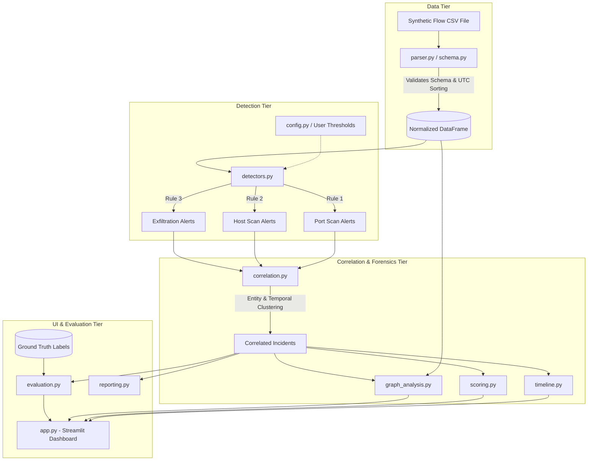

# Document 03: System Architecture & Data Flow

## 1. Architectural Philosophy
NetSleuth is engineered as a **pipeline-oriented, modular, and explainable** cybersecurity analysis framework. Every stage of data transformation is isolated into a dedicated module with well-defined inputs and outputs. This separation ensures:
- High testability via automated unit tests.
- Zero state leakage between detection logic and evaluation metrics.
- Complete transparency: every alert, incident, and score can be audited directly back to the raw flow records that triggered it.

---

## 2. End-to-End Data Flow

The flow of data through NetSleuth follows a strict unidirectional pipeline:

```text
[Synthetic CSV File]
        │
        ▼
[1. Schema Validation & Normalization (parser.py, schema.py)]
        │ (Clean, Sorted pandas DataFrame)
        ▼
[2. Heuristic Detection Engine (detectors.py, config.py)]
        │ (List of Discrete Raw Alert Objects)
        ▼
[3. Incident Correlation Engine (correlation.py)]
        │ (Structured Correlated Incident Clusters)
        ├───► [4. Chronological Timeline Builder (timeline.py)]
        ├───► [5. Directed Graph Topology Modeler (graph_analysis.py)]
        └───► [6. Transparent Risk Scoring Engine (scoring.py)]
                    │
                    ▼
[7. Presentation & Evaluation Layer (app.py, evaluation.py, reporting.py)]
```

---

## 3. Component Architecture & Data Flow Diagram



---

## 4. Module Responsibilities Matrix

The codebase is organized into `src/netsleuth/` with the following distinct functional responsibilities:

| Module File | Class / Responsibility | Input Data | Output Data |
| :--- | :--- | :--- | :--- |
| `config.py` | `NetSleuthConfig` dataclass: holds default detection thresholds, time windows, and weights. | User overrides or defaults | Immutable configuration object |
| `schema.py` | Schema definitions, required column lists, protocol/direction enums, and validation errors. | Raw dictionary / DataFrame rows | Validation status & typed records |
| `parser.py` | Ingests CSV files, validates headers, parses ISO-8601 timestamps to UTC, sorts chronologically, and removes malformed records. | File path or Streamlit UploadedFile | Clean, verified `pandas.DataFrame` |
| `detectors.py` | Houses independent detection functions for vertical port scan, horizontal host sweep, and volumetric outbound spikes using sliding windows. | Clean DataFrame + Config | List of structured `Alert` objects with raw flow references |
| `correlation.py`| Clusters isolated alerts by source IP, common target subnets, and temporal proximity ($\Delta t \le T_{\text{corr}}$). Assigns unique `incident_id`s. | List of `Alert` objects | List of `Incident` objects |
| `timeline.py` | Synthesizes an ordered chronological narrative of an incident, combining raw contributing flows and high-level alert inflection points. | Specific `Incident` + clean DataFrame | Chronological event list / DataFrame for UI plotting |
| `graph_analysis.py` | Constructs a `networkx.DiGraph` representing host communication. Calculates in/out degrees, identifies high-traffic paths, and flags suspicious nodes. | Clean DataFrame + Flagged IPs | `nx.DiGraph` instance + node/edge metadata |
| `scoring.py` | Calculates transparent, explainable incident priority scores ($0–100$) using linear weighted risk models based on alert count, diversity, and data volume. | `Incident` object + Scoring Weights | Numerical score ($0–100$) + human-readable factor breakdown |
| `evaluation.py` | Compares detected incidents/alerts against isolated ground-truth labels (`is_attack`, `attack_type`) to compute Precision, Recall, F1, and Confusion Matrix. | Detected alerts + Ground truth labels | Evaluation metrics dictionary |
| `reporting.py` | Formats correlated incident summaries, timelines, and scoring evidence into clean Markdown and plain-text forensic reports. | `Incident` + Timeline + Score | Formatted Markdown / Text report |
| `app.py` | Top-level Streamlit web dashboard orchestrating the ingestion, parameter tuning, visualization (timeline, graph), and evaluation presentation. | User interactions + NetSleuth modules | Rendered web UI |

---

## 5. Inter-Module Data Contracts

### Clean Flow Record DataFrame Contract
A DataFrame returned by `parser.py` is guaranteed to satisfy:
- Sorted ascending by `timestamp`.
- Timestamps converted to `pandas.DatetimeIndex` (UTC).
- Column types strictly enforced (`src_port` and `dst_port` as integers, `bytes` as non-negative integers).
- Zero NaN values in critical routing columns (`src_ip`, `dst_ip`, `dst_port`).

### Alert Object Contract
An `Alert` returned by any detector in `detectors.py` contains:
```python
{
    "alert_id": "ALT-001",
    "rule_id": "RULE-PORT-SCAN",
    "rule_name": "Vertical Port Scan",
    "timestamp": "2026-10-18T10:15:30Z",
    "src_ip": "192.168.1.50",
    "dst_ip": "10.0.0.15",
    "threshold_details": {"distinct_ports": 25, "threshold": 10, "window_sec": 60},
    "contributing_flow_ids": ["flw-001", "flw-002", ...],
    "severity": "MEDIUM"
}
```

### Incident Object Contract
An `Incident` synthesized by `correlation.py` contains:
```python
{
    "incident_id": "INC-20261018-001",
    "primary_source_ip": "192.168.1.50",
    "associated_ips": ["10.0.0.15", "10.0.0.16", "203.0.113.88"],
    "start_time": "2026-10-18T10:15:00Z",
    "end_time": "2026-10-18T10:28:45Z",
    "alerts": [...], # List of Alert objects
    "risk_score": 85,
    "score_breakdown": {
        "rule_severity_points": 40,
        "target_diversity_points": 20,
        "volume_points": 25
    }
}
```

---

## 6. Execution Model
NetSleuth executes synchronously in-memory:
1. When a user uploads a file or selects a pre-configured synthetic scenario in Streamlit, `parser.py` loads the data into memory.
2. The user adjusts sliders (or leaves defaults) and triggers analysis.
3. In-memory execution completes in seconds because the MVP operates on local tabular structures ($10^3$ to $10^5$ rows).
4. Results are cached in Streamlit session state (`st.session_state`) to enable instant filtering without re-running parsing.
