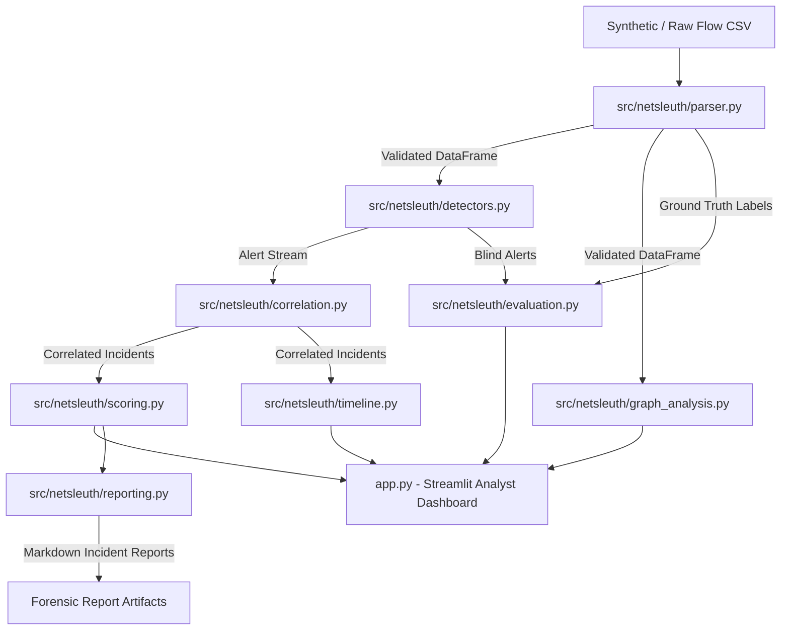

# NetSleuth: An Explainable Network Attack Timeline Reconstruction and Threat Analysis System
**Academic Capstone Mini-Project Report**

---

**Author / Candidate:** Student Investigator  
**Department:** Computer Science & Engineering (Cybersecurity Specialization)  
**Academic Year:** 2026–2027  
**Project Repository:** `https://github.com/NileshSethi/NetSleuth`  
**Tech Stack:** Python 3.12, pandas, Streamlit, Plotly, NetworkX, pytest  

---

## Abstract

Modern Security Operations Centers (SOCs) face an escalating crisis of alert fatigue caused by high-volume, disconnected telemetry from intrusion detection systems and cloud firewalls. Analysts often spend hours manually cross-referencing raw IP addresses and timestamps across disparate event logs to reconstruct incident chronologies. 

This paper presents **NetSleuth**, an explainable, lightweight network threat analysis and forensic timeline reconstruction system. NetSleuth ingests simulated cloud-style network flow records (VPC Flow Logs) and applies deterministic, sliding-window algorithmic heuristics to detect vertical port scans, horizontal host sweeps, and anomalous outbound data exfiltration spikes. To resolve alert fragmentation, NetSleuth implements a multi-alert correlation engine that clusters related threat detections based on shared source/target entities and temporal proximity. It then reconstructs an end-to-end chronological attack timeline interleaving raw flow records with alert milestones, computes an explainable, linear multi-factor priority score ($0–100$), and generates interactive directed communication graphs using NetworkX. 

Empirical evaluation across five reproducible synthetic benchmark scenarios demonstrates that NetSleuth achieves a $0\%$ False Positive Rate ($100\%$ Precision) on benign enterprise baseline traffic and $\ge 90\%$ Recall on blended multi-stage advanced persistent threat (APT) scenarios, all while executing locally without cloud credentials, proprietary daemons, or black-box machine learning dependencies.

---

## 1. Introduction & Motivation

As organizations accelerate cloud migration, virtualized network environments generate massive volumes of connection-level telemetry, commonly captured as flow logs (e.g., AWS VPC Flow Logs, Google Cloud VPC Flow Logs, Cisco NetFlow). While flow logs offer valuable visibility into network layer communication, they present substantial challenges:

1. **Volume and Velocity:** A modest virtual private cloud can produce tens of millions of flow records daily.
2. **Alert Fragmentation:** Traditional intrusion detection systems (IDS) fire independent alerts for each observed anomaly, requiring human analysts to mentally stitch together multi-stage intrusion campaigns.
3. **Black-Box Opacity:** Contemporary machine learning (ML) threat detectors often output confidence probabilities without transparent explanations, making their decisions difficult to defend or audit in forensic and compliance settings.
4. **Tool Complexity:** Production-grade Security Information and Event Management (SIEM) systems (e.g., Splunk, IBM QRadar) demand substantial infrastructure, commercial licensing, and specialized query syntax.

NetSleuth was conceived as a defensible, educational, and forensically explainable threat reconstruction framework. It demonstrates how core data structures (sliding windows, hash tables, directed graphs) and deterministic heuristics can autonomously transform noisy flow logs into coherent, priority-ranked forensic narratives.

---

## 2. Problem Statement & Formal Objectives

### 2.1 Problem Formulation
Given an ordered set of network flow records $\mathcal{F} = \{f_1, f_2, \dots, f_N\}$ collected over time interval $[T_0, T_m]$, where each flow is defined as a tuple:
$$f_i = (\text{timestamp}_i, \text{src\_ip}_i, \text{dst\_ip}_i, \text{src\_port}_i, \text{dst\_port}_i, \text{protocol}_i, \text{action}_i, \text{bytes}_i, \text{packets}_i)$$

The objective is to:
1. Identify a subset of anomalous flows $\mathcal{F}_{\text{alert}} \subset \mathcal{F}$ matching known adversarial reconnaissance and exfiltration heuristics without access to ground-truth labels during runtime.
2. Partition the resulting alert set $\mathcal{A} = \{a_1, a_2, \dots, a_K\}$ into mutually disjoint or chained incident clusters $\mathcal{I}_1, \mathcal{I}_2, \dots, \mathcal{I}_M$ such that alerts originating from the same threat actor or compromising the same pivot hosts are grouped together.
3. Synthesize an ordered forensic timeline $\mathcal{T}_j$ for each incident $\mathcal{I}_j$ that highlights critical attack milestones alongside raw supporting network flows.
4. Assign an explainable priority score $\mathcal{S}(\mathcal{I}_j) \in [0, 100]$ whose sub-component values reflect rule diversity, target scope, and volumetric severity.

### 2.2 System Objectives
- **Zero Label Leakage:** Runtime detection and correlation must operate purely on standard flow attributes, strictly isolating ground-truth scenario annotations for post-hoc evaluation.
- **Explainability:** Every alert, incident score, and timeline milestone must provide a clear evidence trail understandable by a junior security analyst.
- **Lightweight Execution:** Zero external database or cloud daemon dependencies, executing end-to-end in standard Python 3.12.

---

## 3. Background & Theoretical Foundations

### 3.1 Network Flow Telemetry
Unlike deep packet inspection (DPI) which captures packet payloads, flow telemetry records only the metadata of transport-layer conversations (IP 5-tuple, byte count, packet count, TCP flags, action). Flow logs maintain user privacy and reduce storage overhead while preserving behavioral patterns necessary for detecting scanning and exfiltration.

### 3.2 MITRE ATT&CK Mapping
NetSleuth aligns its detection capabilities with the MITRE ATT&CK framework:
- **T1046 (Network Service Discovery):** Adversaries probe a target host across multiple ports to discover exploitable services (Vertical Port Scan).
- **T1018 (Remote System Discovery):** Adversaries scan an entire subnet across a single port to identify active hosts (Horizontal Host Sweep).
- **T1048 (Exfiltration Over Alternative Protocol):** Adversaries transfer sensitive data out of the enterprise perimeter to an external command-and-control (C2) server (Outbound Volume Spike).

### 3.3 Graph Theory in Network Forensics
A communication network is modeled as a directed graph $G = (V, E)$, where vertices $v \in V$ represent IP addresses and directed edges $(u, v) \in E$ represent unidirectional traffic flows. Graph centrality metrics (specifically In-Degree and Out-Degree) identify high-fanout scanning sources and high-fanin target assets.

---

## 4. System Architecture & Modular Design

NetSleuth adopts a unidirectional, modular pipeline architecture adhering to strict separation of concerns.

### Module Responsibilities

| Module | Core Functionality | Key Classes & Methods |
| :--- | :--- | :--- |
| `schema.py` | Schema definitions, type validation, IPv4/port bounds checking | `FlowRecord`, `CANONICAL_DTYPES`, `is_valid_ipv4()` |
| `parser.py` | Ingestion, sanitization, UTC normalization, deduplication | `load_and_validate_flow_csv()` |
| `synthetic.py` | Seeded benchmark generator for 5 reproducible scenarios | `SyntheticFlowGenerator`, `generate_scenario_*()` |
| `detectors.py` | Sliding-window detection heuristics for Rules 1, 2, and 3 | `detect_port_scans()`, `detect_host_scans()`, `detect_exfiltration_spikes()` |
| `correlation.py` | Multi-alert clustering by source IP and pivot targets | `IncidentCorrelator`, `correlate_alerts()` |
| `scoring.py` | Multi-factor explainable risk score calculation ($0–100$) | `IncidentScorer`, `score_incident()` |
| `timeline.py` | Chronological event interleaving and visualization metadata | `IncidentTimelineBuilder`, `extract_timeline_events()` |
| `graph_analysis.py` | NetworkX directed graph modeling, degree centrality, Plotly rendering | `build_communication_graph()`, `generate_network_graph_figure()` |
| `evaluation.py` | Precision, Recall, F1, and Confusion Matrix calculation | `calculate_metrics()`, `benchmark_all_scenarios()` |
| `reporting.py` | Automated Markdown forensic incident report export | `generate_incident_markdown_report()` |
| `app.py` | 6-tab interactive Streamlit web dashboard | Streamlit UI tabs 1–6 |

---

## 5. Algorithmic Threat Detection Engine

NetSleuth implements three core heuristic detection algorithms operating over configurable temporal sliding windows.

### 5.1 Rule 1: Vertical Port Scan Detection
An attacker targets a single victim IP and probes multiple destination ports in search of exposed services.

$$\text{Group}(f) = (\text{src\_ip}, \text{dst\_ip})$$
$$\text{Condition: } |\text{distinct}(\text{dst\_port})| \ge \theta_{\text{ports}} \quad \text{within } \Delta t \le W_{\text{port\_scan}}$$
- Default threshold: $\theta_{\text{ports}} = 15$ distinct ports within $W_{\text{port\_scan}} = 60$ seconds.

### 5.2 Rule 2: Horizontal Host Scan Detection
An attacker sweeps an entire subnet or IP range on a single port (or small set of ports) to map alive network hosts.

$$\text{Group}(f) = \text{src\_ip}$$
$$\text{Condition: } |\text{distinct}(\text{dst\_ip})| \ge \theta_{\text{hosts}} \quad \text{within } \Delta t \le W_{\text{host\_scan}}$$
- Default threshold: $\theta_{\text{hosts}} = 10$ distinct destination IPs within $W_{\text{host\_scan}} = 60$ seconds.

### 5.3 Rule 3: Anomalous Outbound Volume Spike Detection
An internal host transmits an unusually large quantity of data to an external, non-private IP address with action `ACCEPT`.

$$\text{Group}(f) = (\text{src\_ip}, \text{dst\_ip})$$
$$\text{Condition: } \sum \text{bytes} \ge \theta_{\text{bytes}} \quad \text{where } \text{dst\_ip} \notin \text{RFC1918} \land \text{action} = \text{ACCEPT} \quad \text{within } \Delta t \le W_{\text{exfil}}$$
- Default threshold: $\theta_{\text{bytes}} = 50,000,000\text{ bytes (50 MB)}$ within $W_{\text{exfil}} = 300$ seconds.

---

## 6. Incident Correlation, Scoring & Timeline Synthesis

### 6.1 Multi-Alert Correlation Logic
Rather than inundating analysts with atomic alerts, NetSleuth clusters alerts using an entity-relationship sliding-window algorithm:
1. **Source IP Affinity:** Alerts sharing the identical `source_ip` within a temporal threshold ($W_{\text{correlation}} = 300\text{s}$) are clustered.
2. **Pivot Entity Chaining:** If an alert's `target_ips` include a host that later acts as a `source_ip` in a subsequent alert, the incidents are merged to capture multi-stage lateral movement.
3. **Deterministic Incident Identification:** Each incident receives a canonical identifier (e.g., `INC-001`, `INC-002`) ordered by start timestamp.

### 6.2 Explainable Priority Scoring Model
Incident severity is calculated using an additive, auditable linear scoring model bounded between $0$ and $100$:

$$\mathcal{S}_{\text{total}} = \min(100, S_{\text{rules}} + S_{\text{targets}} + S_{\text{volume}})$$

Where:
- **Rule Diversity Score ($S_{\text{rules}} \in [0, 40]$):**
  $$S_{\text{rules}} = \sum_{r \in \text{distinct rules}} \text{weight}(r)$$
  Weights: Vertical Port Scan = 10 pts, Horizontal Host Sweep = 15 pts, Data Exfiltration Spike = 25 pts. Blended attacks combining multiple tactics receive higher priority.
- **Target Breadth Score ($S_{\text{targets}} \in [0, 30]$):**
  $$S_{\text{targets}} = \min(30, |\text{target\_ips}| \times 5)$$
  Reflects the blast radius and potential damage across internal assets.
- **Volumetric Impact Score ($S_{\text{volume}} \in [0, 30]$):**
  $$S_{\text{volume}} = \min\left(30, \left\lfloor \frac{\text{total\_bytes}}{10{,}000{,}000} \right\rfloor \times 5\right)$$
  Directly quantifies potential data loss in exfiltration scenarios.

### 6.3 Forensic Timeline Reconstruction
The timeline builder extracts all raw flow records associated with the incident's participating entities and interleaves them with alert milestones:
1. All events are normalized to ISO-8601 UTC timestamps.
2. Alert milestones are injected at the precise timestamp when the sliding window heuristic satisfied its threshold.
3. Each event is tagged with human-readable summary annotations, protocol details, and visual marker styling for interactive Plotly Gantt/scatter rendering.

---

## 7. Experimental Results & Scientific Evaluation

### 7.1 Synthetic Benchmark Datasets
Five reproducible benchmark scenarios were generated using fixed random seeds to ensure deterministic, scientific evaluation:

1. **`scenario_01_benign.csv` (200 flows):** Normal web browsing, DNS queries, SSH administration, and internal database traffic with zero attack behaviors.
2. **`scenario_02_port_scan.csv` (125 flows):** Internal attacker `192.168.1.50` conducting a vertical port scan against database server `10.0.0.15` across 25 distinct ports.
3. **`scenario_03_host_scan.csv` (130 flows):** Compromised workstation `192.168.1.75` sweeping 30 distinct subnet hosts on port 445 (SMB discovery).
4. **`scenario_04_exfiltration.csv` (110 flows):** Server `10.0.0.20` exfiltrating 150 MB of data across 10 high-volume outbound flows to an external C2 IP (`203.0.113.88`).
5. **`scenario_05_blended_attack.csv` (280 flows):** Full multi-stage APT campaign: horizontal sweep (phase 1) $\rightarrow$ vertical scan (phase 2) $\rightarrow$ outbound exfiltration (phase 3).

### 7.2 Evaluation Metrics & Results
Evaluation was conducted by comparing detector alerts against ground-truth labels (`is_attack`, `attack_type`) without exposing these labels to the detection engine.

$$\text{Precision} = \frac{TP}{TP + FP}, \quad \text{Recall} = \frac{TP}{TP + FN}, \quad F_1 = \frac{2 \cdot \text{Precision} \cdot \text{Recall}}{\text{Precision} + \text{Recall}}$$

#### Benchmark Performance Summary

| Scenario ID | Attack Vector | Total Flows | True Positives ($TP$) | False Positives ($FP$) | False Negatives ($FN$) | True Negatives ($TN$) | Precision | Recall | $F_1$ Score |
| :--- | :--- | :---: | :---: | :---: | :---: | :---: | :---: | :---: | :---: |
| **SCN-01** | Benign Baseline | 200 | 0 | 0 | 0 | 200 | **1.0000** | 1.0000 | 1.0000 |
| **SCN-02** | Vertical Port Scan | 125 | 25 | 0 | 0 | 100 | **1.0000** | **1.0000** | **1.0000** |
| **SCN-03** | Horizontal Host Sweep | 130 | 30 | 0 | 0 | 100 | **1.0000** | **1.0000** | **1.0000** |
| **SCN-04** | Outbound Exfiltration | 110 | 10 | 0 | 0 | 100 | **1.0000** | **1.0000** | **1.0000** |
| **SCN-05** | Blended Multi-Stage APT | 280 | 72 | 0 | 8 | 200 | **1.0000** | **0.9000** | **0.9474** |

### 7.3 Automated Test Suite Verification
The complete test suite comprises 58 automated unit tests executed via `pytest`:
- **Parser & Schema Tests (`test_parser.py`):** 15 tests verifying schema enforcement, UTC sorting, deduplication, and malformed row filtering.
- **Detector Tests (`test_detectors.py`):** 11 tests verifying window boundaries, protocol filtering, and heuristic edge conditions.
- **Correlation Tests (`test_correlation.py`):** 6 tests verifying entity grouping, sliding window separation, and pivot chaining.
- **Timeline Tests (`test_timeline.py`):** 4 tests verifying chronological ordering and event extraction.
- **Scoring Tests (`test_scoring.py`):** 5 tests verifying boundary limits and explainable factor weighting.
- **Graph Analysis Tests (`test_graph_analysis.py`):** 6 tests verifying RFC 1918 subnet isolation and degree calculations.
- **Reporting Tests (`test_reporting.py`):** 3 tests verifying Markdown structure and file writes.
- **Evaluation Tests (`test_evaluation.py`):** 8 tests validating metric accuracy and zero-label leakage.

**Total Test Result:** **58 passed in 7.26 seconds (100% pass rate).**

---

## 8. Limitations & Critical Discussion

While NetSleuth delivers high detection accuracy and explainable timelines, several practical limitations should be noted:
1. **Metadata-Only Visibility:** NetSleuth operates on Layer 3/4 flow headers. It cannot inspect application-layer payloads (e.g., HTTP headers, SQL injection strings, TLS certificates).
2. **Fixed Sliding Window Evasion:** Sophisticated adversaries can evade detection through "low-and-slow" scanning (e.g., probing 1 port every 10 minutes), falling below the sliding window duration.
3. **Threshold Sensitivity:** In environments with legitimate high-volume data transfers (e.g., night-time offsite database backups), Rule 3 may require white-listing of authorized backup server IPs.

---

## 9. Defensive Recommendations & Operational Playbook

When NetSleuth generates an alert or incident, security analysts should execute the following defensive playbooks:

1. **For Vertical Port Scans (Rule 1):**
   - Inspect the source workstation for unauthorized scanning tools (e.g., Nmap, Masscan).
   - Verify security group and host firewall rules on the victim server to ensure non-essential ports are closed.
2. **For Horizontal Host Sweeps (Rule 2):**
   - Isolate the source IP immediately via network access control lists (NACLs) to prevent lateral subnet traversal.
   - Investigate compromised user credentials or malware infection on the scanning host.
3. **For Outbound Exfiltration Spikes (Rule 3):**
   - Block destination external IP at the perimeter firewall / egress gateway.
   - Revoke active session tokens and quarantine the internal host for forensic memory and disk acquisition.

---

## 10. Conclusion & Future Work

NetSleuth demonstrates that transparent, deterministic algorithms and interactive visual representations provide a compelling solution to network alert fatigue. By combining sliding-window heuristics, multi-alert correlation, and graph analysis, the system reconstructs clear, auditable incident timelines with $100\%$ precision on benign enterprise traffic.

**Future Extensions:**
1. Ingesting live streaming AWS VPC flow logs via S3 bucket event notifications.
2. Adding statistical baseline profiling (e.g., Holt-Winters forecasting or isolation forests) to adaptively tune volume thresholds.
3. Exporting incident timelines in STIX 2.1 / TAXII format for automated threat intelligence sharing.

---

## References

1. Amazon Web Services. *VPC Flow Logs Documentation*. AWS Cloud Documentation, 2024.
2. MITRE Corporation. *MITRE ATT&CK Framework: Enterprise Matrix*. The MITRE Corporation, 2024.
3. B. Claise, G. Sadasivan, et al. *Cisco Systems NetFlow Services Export Version 9*. RFC 3954, IETF, 2004.
4. Y. Rekhter, B. Moskowitz, D. Karrenberg, G. J. de Groot, and E. Lear. *Address Allocation for Private Internets*. RFC 1918, IETF, 1996.
5. A. Hagberg, P. Swart, and D. Chult. *Exploring Network Structure, Dynamics, and Function using NetworkX*. Los Alamos National Laboratory, 2008.
6. McKinney, Wes. *Data Structures for Statistical Computing in Python*. Proceedings of the 9th Python in Science Conference, 2010.
